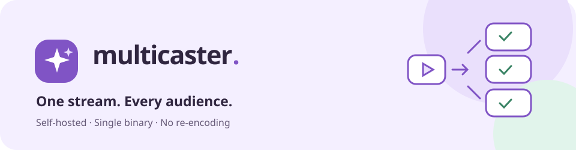

<p align="center">
  
</p>

<p align="center">
  <a href="https://github.com/TrueFix/Multicaster/releases/latest"></a>
  <a href="https://github.com/TrueFix/Multicaster/actions/workflows/ci.yaml"></a>
  <a href="LICENSE"></a>
</p>

**Send one stream from OBS. Share it with every platform you choose.**

Multicaster is an open-source, self-hosted RTMP relay with a friendly web dashboard. It forwards H.264/AAC video to multiple RTMP or RTMPS destinations without re-encoding. The dashboard, API and media server run together in **one binary**.

## What you get

- **Go live in more places.** Connect YouTube, Twitch and custom RTMP services. Toggle each platform during a stream without reconnecting the others.
- **Keep the processing light.** Passthrough video, bounded output queues and independent reconnection. No FFmpeg, GPU or Node.js required at runtime.
- **Watch when you want.** Optional browser-friendly HLS playback, with dashboard preview off by default.
- **Use your own infrastructure.** Optional S3-compatible HLS publishing for AWS, Cloudflare R2 and compatible storage.
- **Stay in control.** Password-protected dashboard, guided setup, system information and manual update checks using the built-in release manifest.

## Get started

### 1. Download

Choose a binary from the [latest release](https://github.com/TrueFix/Multicaster/releases/latest):

| System | Intel / AMD 64-bit | ARM64 / Apple Silicon |
|---|---|---|
| Linux | [Download](https://github.com/TrueFix/Multicaster/releases/latest/download/multicaster-linux-amd64) | [Download](https://github.com/TrueFix/Multicaster/releases/latest/download/multicaster-linux-arm64) |
| Windows | [Download](https://github.com/TrueFix/Multicaster/releases/latest/download/multicaster-windows-amd64.exe) | [Download](https://github.com/TrueFix/Multicaster/releases/latest/download/multicaster-windows-arm64.exe) |
| macOS | [Download](https://github.com/TrueFix/Multicaster/releases/latest/download/multicaster-macos-amd64) | [Download](https://github.com/TrueFix/Multicaster/releases/latest/download/multicaster-macos-arm64) |

<details>
<summary><strong>Install with a script instead</strong></summary>

Linux and macOS:

```sh
curl -fsSLO https://github.com/TrueFix/Multicaster/releases/latest/download/install.sh
sh install.sh
~/.local/bin/multicaster
```

Windows PowerShell:

```powershell
Invoke-WebRequest https://github.com/TrueFix/Multicaster/releases/latest/download/install.ps1 -OutFile install.ps1
powershell -ExecutionPolicy Bypass -File .\install.ps1
& "$env:LOCALAPPDATA\Programs\Multicaster\multicaster.exe"
```

The installers select your architecture, verify SHA-256 and the executable version, and preserve your configuration. You can always run the standalone binary instead.

</details>

### 2. Start Multicaster

Run the downloaded executable in a terminal. On Linux/macOS, make it executable first:

```sh
chmod +x multicaster-linux-amd64
./multicaster-linux-amd64
```

Use the filename you downloaded. On Windows, run `multicaster-windows-amd64.exe` in PowerShell.

Open the setup link printed in the terminal and create your dashboard password. Configuration and stream keys are generated automatically. The dashboard is at **http://localhost:8080/app/**.

### 3. Connect OBS

1. In Multicaster, open **Settings → General** and copy your **OBS server URL** and **stream key**.
2. In OBS, open **Settings → Stream**, choose **Custom**, and paste both values.
3. Add your streaming platforms in the dashboard using their own server URLs and keys.
4. Start streaming in OBS.

Use **H.264 video**, **AAC audio** and a **2-second keyframe interval**. Every destination receives the same resolution and bitrate, so choose OBS settings that all your platforms accept.

## Docker

```sh
git clone https://github.com/TrueFix/Multicaster.git
cd Multicaster
docker compose up --build -d
docker compose logs multicaster
```

The included Compose file exposes **1935/TCP** for RTMP and **8080/TCP** for the dashboard, API and HLS. Configuration persists in a named volume. For a VPS, replace the loopback host in the setup link with your server's address; use HTTPS for remote dashboard access.

## Settings that stay with you

No config flag is required. Multicaster uses a fixed location:

| System | Configuration |
|---|---|
| Linux | `~/.config/multicaster/config.yaml` — respects `XDG_CONFIG_HOME` |
| Windows | `%APPDATA%\multicaster\config.yaml` |
| macOS | `~/Library/Application Support/multicaster/config.yaml` |
| Docker | `/app/data/config.yaml` |

Forgot your password? Run the same executable with **`--reset-password`**. A running instance opens a new password-setup flow without restarting its live relay. Use `--no-browser` on a headless server.

The official update feed is already configured:

```text
https://github.com/TrueFix/Multicaster/releases/latest/download/update-manifest.json
```

Check for updates under **Settings → Updates**. Downloads are platform-specific and include SHA-256 metadata. Updates are manual: finish your stream before replacing the executable or restarting a container.

## Build and contribute

Requirements: **Go 1.26+**, **Node.js 22.12+**, and **Python 3.10+** for release tooling.

```sh
make build       # Build the dashboard and standalone executable
make check       # Go race tests, vet, frontend unit tests and release-tool checks
```

See [configuration](docs/CONFIGURATION.md), [development and testing](docs/DEVELOPMENT.md), and [releasing a version](docs/RELEASING.md) for details.

## License

[MIT](LICENSE). Third-party dependencies retain their respective licenses.
